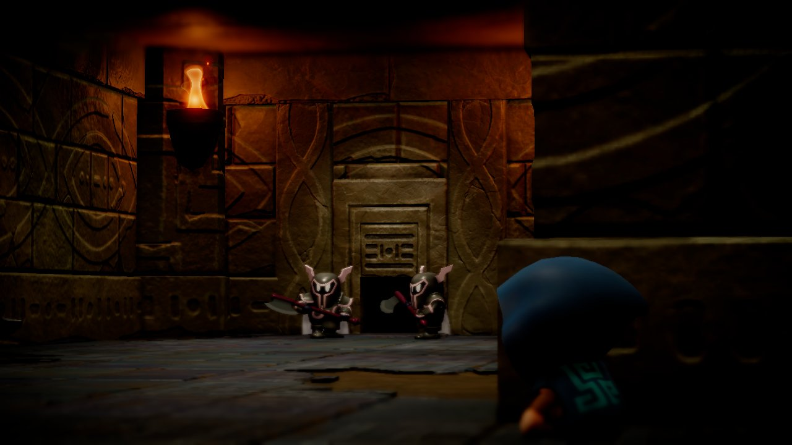
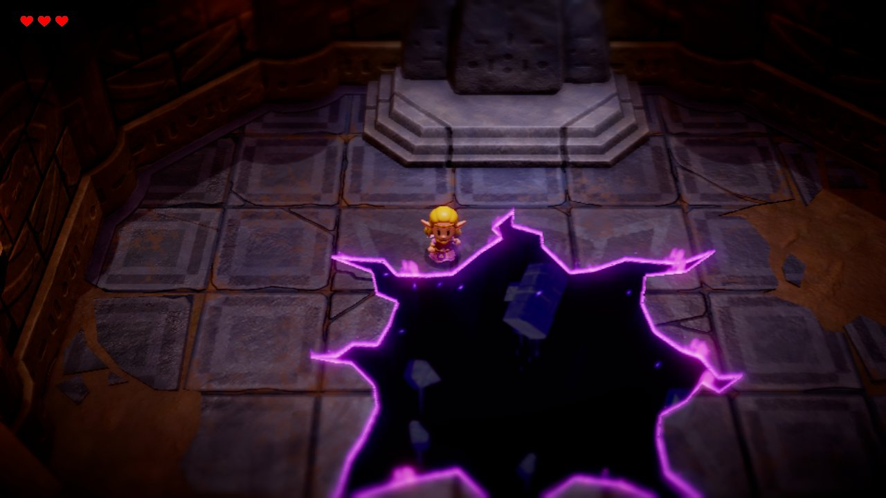
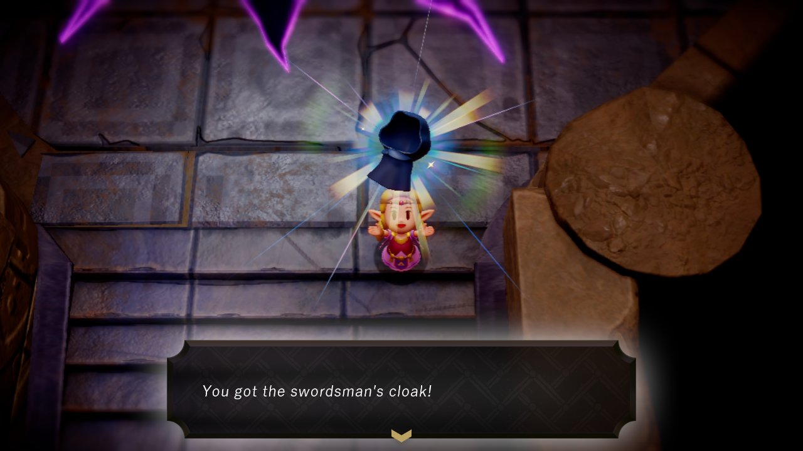
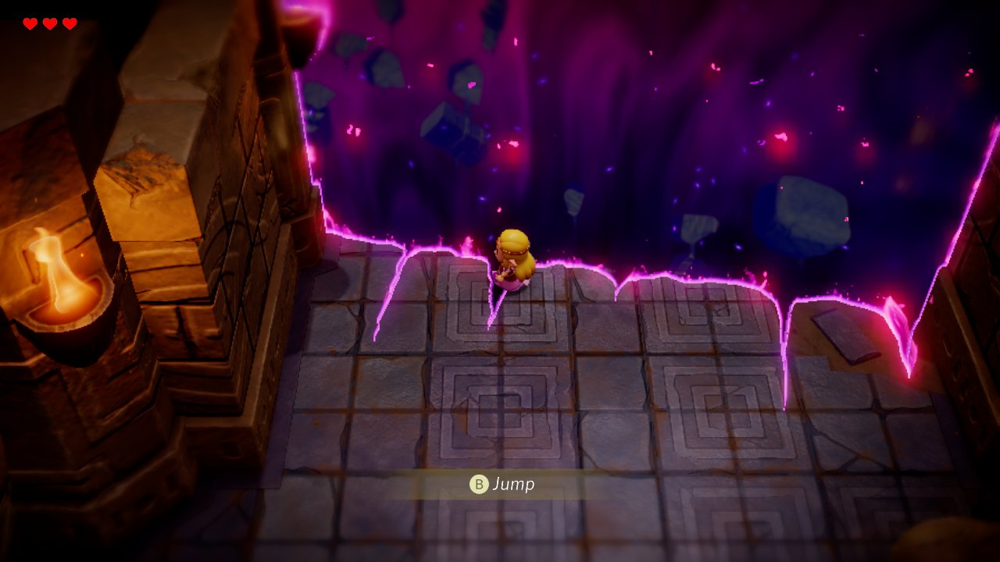
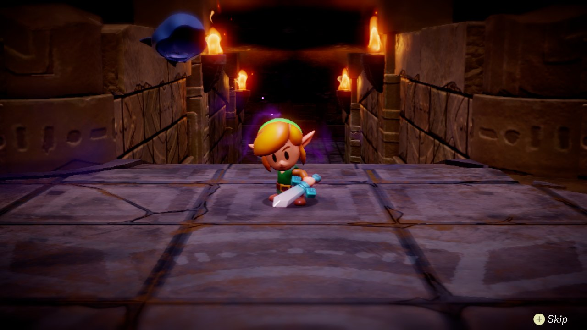
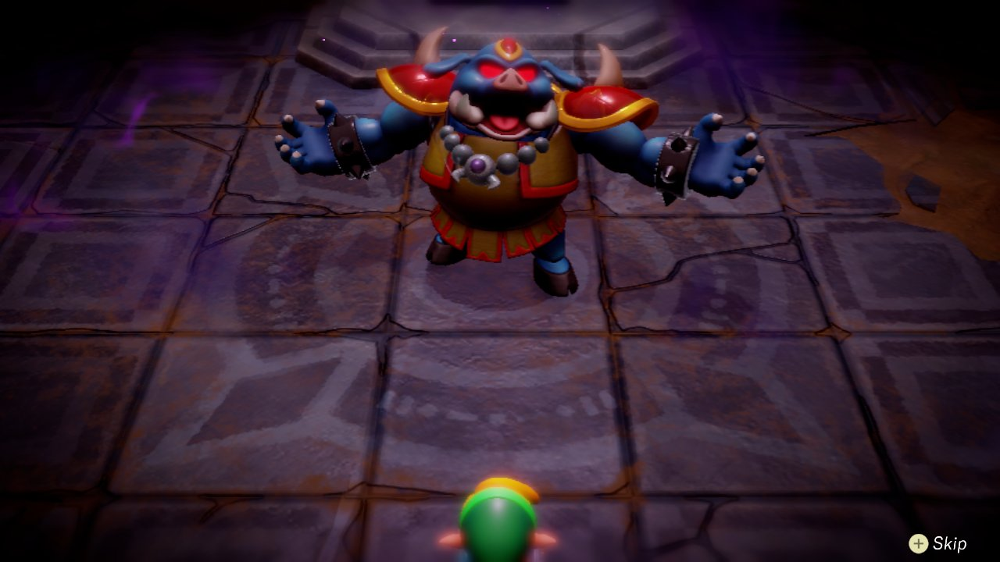
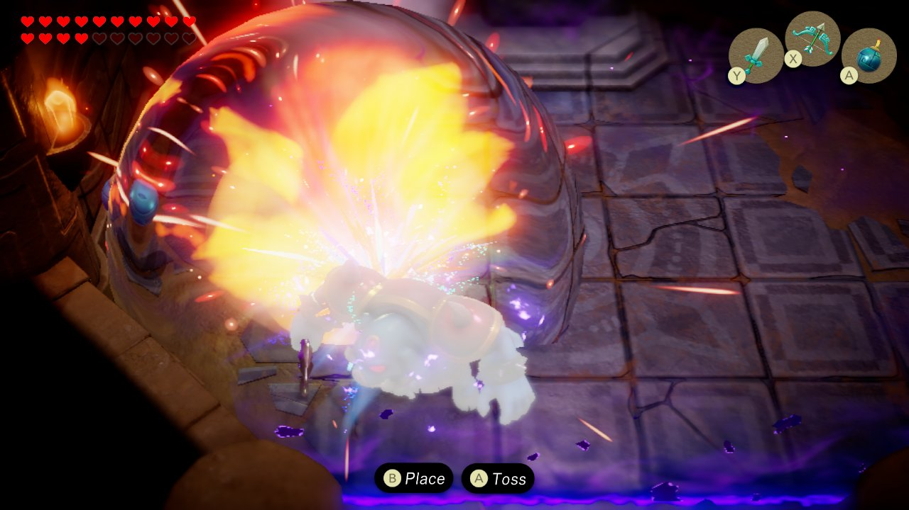

<p align="center">
  
</p>

<h1 align="center">EoWRecomp - Windows / NVIDIA fork</h1>

<p align="center">
  <b>Static recompilation of <i>The Legend of Zelda: Echoes of Wisdom</i> (Nintendo Switch, 2024)</b><br>
  <b>This fork: Windows 11 + NVIDIA (Vulkan) testing and fixes</b>
</p>

<p align="center">
  
  
  
  
  
</p>

---

EoWRecomp translates the game's ARM64 machine code into C ahead of time and recompiles it for the PC. Its runtime
replaces the Switch operating-system services the game uses and implements the NVN graphics API on top of Vulkan.

This fork follows **[patrickksmdev/EoWRecomp](https://github.com/patrickksmdev/EoWRecomp)** (developed and tested on
Linux, playable to the Gerudo Desert) and tests it on **Windows 11 with an NVIDIA RTX 3070 Laptop GPU**. Our changes are
offered back to that project in
[patrickksmdev/EoWRecomp#1](https://github.com/patrickksmdev/EoWRecomp/pull/1); the work branch is
[`win-on-patrick`](https://github.com/shkankin/EoWRecomp/tree/win-on-patrick).

> [!WARNING]
> **No game files are included.** You need your own legally obtained copy of *The Legend of Zelda: Echoes of Wisdom*
> v1.0.0 (title ID `01008CF01BAAC000`) and your own `prod.keys`; the v1.1.0 update works too (put your update `.nsp`
> in the same folder as the `.xci` / `.nsp`). This repository does not provide game files, keys, or instructions for
> obtaining them.

## Screenshots (Windows 11, RTX 3070 Laptop, 1280x720)

Frames captured by the runtime itself from the recompiled game.

| | |
|:-:|:-:|
|  |  |
| Prologue | A rift in the Suthorn Ruins floor |
|  |  |
| "You got the swordsman's cloak!" | At the edge of the void |
|  |  |
| Prologue cutscene | Ganon |
|  | |
| The Ganon fight | |

## Windows status (2026-11-24)

What has been seen working on Windows 11 / RTX 3070 Laptop:

- **Boot, new game and saves:** the prologue from an empty save; existing saves list and load.
- **60 fps** with the built-in frame limiter (`F1` -> Video), through the prologue, the Ganon fight, Suthorn Ruins
  and past the title card. Played by hand with real saves: no problems besides the first-time shader hitches below.
- **Rifts / the void render correctly**, including the floor rifts that an older Windows build drew wrong.

Fixed in this fork (each verified by repeated scripted runs; details in [docs/STATUS.md](docs/STATUS.md), Portuguese):

- **NVIDIA device loss after Zelda gets the swordsman's cloak** (`VK_ERROR_DEVICE_LOST`, about 1 run in 4-6). A depth
  snapshot was reused after the game had rebuilt that texture at another size or format, so the rift shader read memory
  that didn't exist. 8 of 16 runs crashed before the fix, 0 of 16 after.
- **Stutter every 30 s** while new graphics appeared: the ~100 MB pipeline cache was written to disk on the render
  thread. It is saved in the background now.
- **Shader preparation without the start screen:** `EOWRECOMP_SHADER_PREP=1` now pre-compiles the known shaders when the
  game is started directly (`--play` / `EOWRECOMP_NO_LAUNCHER=1`). The start screen always does it.
- **Windows build fixes:** the game library's link no longer overwrites the runtime's import library; POSIX `rename`
  semantics.
- **Debug tools:** `EOWRECOMP_VK_CHECKPOINTS=1` (NVIDIA: names the draw a GPU crash happened in), vertex shader input
  dump + CPU emulator (`EOWRECOMP_VS_DUMP`, `tools/vsemu.py`), `EOWRECOMP_DUMP_SHADERS`, `--romfs-src` for
  `tools/nca_extract.py`.

### Known issues on Windows

- **Hitches the first time new graphics appear**: the NVIDIA driver takes 0.1-0.6 s to build some full-screen shaders the
  first time. `F1` -> Video -> **Shader compilation** decides what happens meanwhile: `Async` (default in this fork)
  never waits - smooth (worst ~0.2 s measured), at the cost of a one-frame flash the first time a big effect appears;
  `Sync` waits - no glitches, but stalls of up to ~2 s on a fresh install (drops to 1-3 fps on a Radeon 890M);
  `Smart` is in between. Once the shader cache (`cache/`) has them, all three play about the same.
- **Audio** is not verified yet (the test machine has no sound output).
- Only one Windows machine (NVIDIA) has been tested; AMD / Intel GPUs on Windows are untested.

## Building for Windows

Cross-built from Linux / WSL with zig cc: run `tools/windows/fetch_deps.sh` once, then

```bash
tools/windows/build.sh -j16    # -> build/win/dist/EoWRecomp/ (eowrecomp.exe, eowgame.dll and the DLLs)
```

See the header of `tools/windows/build.sh` and [docs/BUILD-windows.md](docs/BUILD-windows.md) (native MSYS2 build).
The game code (`generated/`) is made from your own game files with `tools/nca_extract.py` and `make gen`; it is never
committed.

## How it works

- **Recompiler** (`tools/`): analyzes the game's ARM64 modules, resolves functions and jump tables, and generates C code.
- **Runtime** (`runtime/`): implements the Horizon services used by the game, including threads, synchronization, filesystem, input and audio.
- **Graphics**: reimplements NVN on Vulkan and translates Maxwell GPU shaders to GLSL.
- **Game package reader** (`runtime/nxpkg.c`): reads NSP/XCI/NCA packages using the user's keys. The RomFS can be read directly from the package instead of requiring a second multi-gigabyte copy.

## Contributing & Debugging

- `docs/STATUS.md` is the detailed engineering log (in Portuguese): what works, what broke, hypotheses ruled out, and next steps.
- `CLAUDE.md` holds the project rules (no Nintendo files in the repo, never edit `generated/` by hand, every patch checks the original instruction word, a fix counts only once seen working).
- Tests live in `tools/` (`test_translate`, `test_shaders`, `test_simd`, `test_lift`, `test_lane.sh`, `test_stencil.sh`).
- **F9 debug capture:** press F9 in game to save the next frame's render passes (`build/pass_*.png`), the draw log, and, with `EOWRECOMP_SAVE_MSL=1`, the translated GLSL in `build/shaders`.
- Debug switches all start with `EOWRECOMP_` (search `getenv("EOWRECOMP_` in `runtime/`).

## Development status

See **[docs/STATUS.md](docs/STATUS.md)** for the detailed technical log:
- Windows test results and performance observations
- Vulkan/Radeon shader and pipeline investigations
- SUST and compute-shader progress
- Remaining graphics bugs and diagnostic instructions

## Credits

- **[EoWRecomp original project](https://github.com/Nycolazs/EoWRecomp)** by **Nycolazs** — original project and foundation.
- **[patrickksmdev/EoWRecomp](https://github.com/patrickksmdev/EoWRecomp)** by **Patrick** — the Linux tree this fork follows (shader preparation, frame limiter, rift fixes and much more).
- **[requiemjota88/EoWRecomp](https://github.com/requiemjota88/EoWRecomp)** — `beta 1` base of patrickksmdev's tree (GPU culling, stencil views, watchdog).
- **[tcsenpai/EoWRecomp](https://github.com/tcsenpai/EoWRecomp)** — backported `gen.py` jump-table, frame-pacing, pipeline cache, and storing-fs fixes.
- **[LAS Recomp](https://github.com/peiikai/LASRecomp)** by Peiikai and contributors — the foundation for the recompiler, runtime, NVN implementation, Maxwell shader translator and Vulkan renderer.
- [SDL 3](https://libsdl.org), [FFmpeg](https://ffmpeg.org), [Dear ImGui](https://github.com/ocornut/imgui), [Vulkan](https://www.vulkan.org), [volk](https://github.com/zeux/volk), [Vulkan Memory Allocator](https://github.com/GPUOpen-LibrariesAndSDKs/VulkanMemoryAllocator), [shaderc](https://github.com/google/shaderc), [SMAA](https://github.com/iryoku/smaa) and [AMD FidelityFX FSR 1](https://github.com/GPUOpen-Effects/FidelityFX-FSR).
- Documentation and research references: [Switchbrew](https://switchbrew.org), [envytools](https://github.com/envytools/envytools), and the instruction decoders of Ryujinx and yuzu.

patrickksmdev's tree is developed with AI assistance from [Gemini](https://gemini.google.com) (Google); the Windows work in this fork is done with [Claude Code](https://claude.com/claude-code) (Anthropic), under human direction and testing.

## Legal

EoWRecomp is an independent fan project and is not affiliated with, endorsed by, or sponsored by Nintendo. *The Legend of Zelda* and *Echoes of Wisdom* are trademarks of Nintendo. No game files, game code, assets or keys are included. You must provide your own legally obtained copy of the game.

## License

EoWRecomp's original code is licensed under MIT. Third-party components retain their respective licenses. This license grants no rights to Nintendo's game or other copyrighted content.
